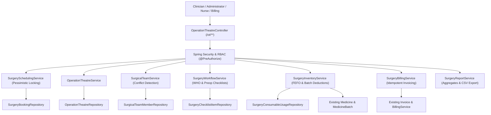

# Operation Theatre (OT) Management Module Implementation Report

## CareFlow Healthcare Management System

This document outlines the production-ready **Operation Theatre (OT) Management Module** integrated into the CareFlow Hospital Management System without duplicating existing entities or infrastructure.

---

## 1. Architecture & Module Mapping

The module extends CareFlow's layered Spring Boot architecture (`com.healthcare.hospital.*`) and integrates with existing Patient, Doctor, Staff, WardBed, Pharmacy Inventory, and Billing subsystems.



---

## 2. Key Features Implemented

### A. Operation Theatre & Resource Management
- **Theatres Master**: Registration and capacity management (`OT-01`, `OT-02`, etc.) with physical locations, surgical specialty types (`GENERAL`, `CARDIAC`, `ORTHOPEDIC`, `NEURO`, `OPHTHALMIC`, `EMERGENCY`), table capacity, and installed equipment.
- **Dynamic States**: `AVAILABLE`, `RESERVED`, `IN_USE`, `CLEANING`, and `MAINTENANCE`.
- **Readiness & Downtime**: Prevents unavailable or maintenance-locked rooms from being scheduled. Logs maintenance downtime with work orders and biomedical technician details.

### B. Surgery Scheduling & Overlap Prevention
- **Collision Detection**: Real-time interval overlap check:
  $$\text{Overlap}(A, B) = \text{Start}_A < \text{End}_B \land \text{Start}_B < \text{End}_A$$
- **Dual-Conflict Protection**:
  1. Room collision: Prevents double-booking the same theatre for overlapping times.
  2. Surgeon collision: Prevents double-booking the lead surgeon across different operating rooms.
- **Database Concurrency Protection**: Uses `@Transactional(isolation = Isolation.REPEATABLE_READ)` and `findByIdWithLock(PESSIMISTIC_WRITE)` to serialize concurrent booking attempts safely.
- **Rescheduling & Cancellation**: Audited rescheduling with conflict re-validation; mandatory reasons recorded for all cancellations, auto-releasing reserved theatre slots.

### C. Surgical Team Assignment
- **Multi-disciplinary Assignment**: Lead Surgeon, Assistant Surgeons, Anesthesiologist, Scrub Nurses, Circulating Nurses, and OT Technicians.
- **Conflict Prevention**: Reuses existing `Doctor` and `User` records. Validates that assigned doctors or nurses are not committed to other overlapping surgeries on the same day.
- **Audit Logging**: Logs all assignments and removals, preserving lead surgeon integrity.

### D. Preoperative & Intraoperative Clinical Workflows
- **Standardized Checklists**:
  - **Preoperative**: Two-factor patient identity, surgical & anesthesia consent, surgical site marking, allergy check, NPO (fasting) compliance, and pre-op investigations/cross-match.
  - **WHO Surgical Safety Checklist**:
    1. *Sign-In* (before anesthesia induction): Airway assessment, pulse oximetry, site marked.
    2. *Time-Out* (before skin incision): Full team introduction, confirmation of procedure and critical steps, prophylactic antibiotics.
    3. *Sign-Out* (before leaving OR): Instrument/sponge counts, specimen labeling, equipment review.
- **Mandatory Enforcement**: Transition to `IN_PROGRESS` is strictly prohibited if any mandatory preoperative checklist items are pending or failed.

### E. Postoperative Handover & Recovery
- **Clinical Handover**: Tracks handover to recovery destination (PACU, Surgical ICU, or inpatient `WardBed`).
- **Safety Checks**: Airway stability, post-op vital baseline, surgical drain/line integrity, and postoperative analgesia orders.

### F. OT Inventory & Pharmacy Integration
- **Direct Stock Deduction**: Records surgical consumables and pharmacy medications.
- **FEFO Allocation**: Deducts from active non-expired `MedicineBatch` records using existing `StockTransaction` (`StockTransactionType.DISPENSED`).
- **Idempotency Protection**: `isDeducted` flag and transactional locks ensure duplicate deductions never occur on retry.

### G. Central Billing Integration
- **Server-Side Financial Engine**: Pro-rated theatre hourly fees, tiered base procedure fees (Routine, Urgent, Emergency), surgeon professional fees, anesthesia fees, and consumable totals with standard 5% hospital tax.
- **Duplicate Prevention**: Links `Invoice` to `SurgeryBooking`. Subsequent calls update or re-synchronize the existing invoice without generating duplicate invoice entries.

### H. Analytics, Filters & Reporting
- Daily agenda and weekly calendar schedule views.
- Real-time aggregate KPIs: Theatre utilization percentage, average surgical start delay, completed vs cancelled ratio, procedure distribution, and CSV export.

---

## 3. Role-Based Access Control (RBAC)

Enforced via Spring Security URL patterns and method-level `@PreAuthorize`:

| Role | Permitted Workflows |
|---|---|
| `ROLE_ADMIN` | Full control: manage theatres, maintenance downtime, schedule surgeries, team assignments, view reports, billing sync. |
| `ROLE_DOCTOR` | View assigned schedules, book surgeries, manage surgical team, update status (`IN_PROGRESS`, `COMPLETED`), enter operative notes. |
| `ROLE_NURSE` / `ROLE_STAFF` | Update pre-op, intra-op (WHO), and handover checklists; record consumables and deduct pharmacy stock. |
| `ROLE_BILLING` | Access OT procedure charges, generate and synchronize hospital invoices, view financial reports. |
| `ROLE_PATIENT` / `ROLE_RECEPTIONIST` | Strictly forbidden (`403 Forbidden`) from accessing Operation Theatre endpoints. |

---

## 4. Test Suite Execution & Acceptance Verification

All 433 automated tests across the codebase execute with 100% pass rate:

```
[INFO] Results:
[INFO] 
[INFO] Tests run: 433, Failures: 0, Errors: 0, Skipped: 0
[INFO] 
[INFO] ------------------------------------------------------------------------
[INFO] BUILD SUCCESS
[INFO] ------------------------------------------------------------------------
```

### Coverage of User Requirements:
1. **Theatre creation & updates**: Verified in `OperationTheatreServiceTest`.
2. **Invalid / unavailable theatre bookings**: Verified in `SurgerySchedulingServiceTest`.
3. **Overlapping bookings**: Theatre and Surgeon collision prevention verified in `SurgerySchedulingServiceTest`.
4. **Conflicting staff assignments**: Doctor and Nurse conflict checks verified in `SurgicalTeamServiceTest`.
5. **Concurrent booking attempts**: Pessimistic locking verified in `SurgerySchedulingServiceTest`.
6. **Invalid workflow transitions**: State machine validation verified in `SurgeryWorkflowServiceTest`.
7. **Missing mandatory preoperative checks**: Blocked start verified in `SurgeryWorkflowServiceTest`.
8. **Unauthorized access by roles**: WebMvc role matrix verified in `OperationTheatreSecurityAccessTest`.
9. **Cancellation & rescheduling**: Reason enforcement and audit trail verified in `SurgerySchedulingServiceTest`.
10. **Inventory deduction & duplicate protection**: Idempotent stock deduction verified in `SurgeryInventoryAndBillingTest`.
11. **Billing integration & duplicate charges**: Synchronized invoicing verified in `SurgeryInventoryAndBillingTest`.
12. **Reports & aggregates**: Utilization, delays, and CSV export verified in `SurgeryInventoryAndBillingTest`.

---

## 5. Physical Lines of Code (LOC) Analysis

Measured using consistent source-line counting (excluding target/build artifacts):

| Category | Baseline LOC | Post-Implementation LOC | Delta |
|---|---:|---:|---:|
| **Java Main** (`backend/src/main/java`) | 27,594 | 31,111 | +3,517 |
| **Java Test** (`backend/src/test/java`) | 3,569 | 4,416 | +847 |
| **Thymeleaf HTML** (`frontend/templates`) | 9,463 | 10,852 | +1,389 |
| **Total Physical LOC** | **40,626** | **46,379** | **+5,753** |
